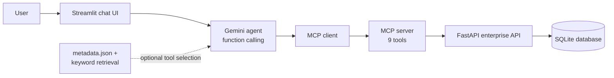

# TechNova Enterprise AI Agent

A natural-language assistant for a fictional company (TechNova GmbH). Employees
ask questions or request changes in plain English. A Gemini-powered agent picks
the right tool, calls it through the Model Context Protocol (MCP), and reads or
updates a simulated enterprise system (FastAPI + SQLite).

All business data is fictional. Built as a university project.

## Architecture



| Component | Role |
|---|---|
| Streamlit (`app.py`) | Chat UI, shows each tool call, confirm/cancel buttons for writes |
| Gemini agent (`agent/`) | Understands the request, chooses a tool, extracts parameters, writes the answer. It only decides; our code executes. |
| MCP client (`tools/mcp_client.py`) | Discovers the tools and calls them |
| MCP server (`tools/mcp_server.py`) | Exposes 9 enterprise operations as tools with schemas. Holds no data; calls the backend. |
| FastAPI backend (`backend/`) | The simulated enterprise software (REST API, Swagger at `/docs`) |
| SQLite (`data/enterprise.db`) | Customers, orders, products, invoices |
| Metadata (`data/metadata.json`, `retrieval/`) | Describes what the system can do. Keyword search can narrow the tools offered to Gemini (sidebar switch). |

## Safety design

- Write operations (`update_order_status`) are marked `write` in `metadata.json`.
- The agent never executes a write itself. It previews the change, then waits.
  Only the UI's Confirm button calls `confirm_pending()`.
- The code raises an error if a write is attempted without confirmation, so the
  model cannot bypass it.
- After a confirmed write, the order is read again to verify the new status.
- Statuses and IDs are validated in the agent, the MCP server, the API and the
  database constraints.
- Tool calls are logged in `logs/tool_calls.log` and `logs/agent.log`.

## Setup

Tested on Windows with Python 3.14.0. Other versions are untested.

```powershell
python -m venv .venv
.venv\Scripts\Activate.ps1
pip install -r requirements.txt
```

Create a `.env` file (see `.env.example`):

```
GEMINI_API_KEY=your_key_here
GEMINI_MODEL=your_model_name_here
```

Get a free key at aistudio.google.com. Use a Flash or Flash-Lite model that is
available on the free tier. Do not enable billing. The model used during
development was `gemini-3.5-flash-lite`; model names change, so check the
models your key can access.

## Run

Terminal 1 (backend):

```powershell
python -m data.seed_data
uvicorn backend.api_server:app --reload
```

Terminal 2 (chat UI):

```powershell
streamlit run app.py
```

Open http://localhost:8501. The API documentation is at http://127.0.0.1:8000/docs.

`python -m data.seed_data` resets the data. Run it before starting the backend
and after any demo that changed an order.

## Example requests

| Request | Expected behaviour |
|---|---|
| Find customer 1025. | `get_customer`, returns ABC Technologies GmbH |
| Show all pending orders from German customers. | `search_orders`, orders 5001 and 5003 |
| Which products have less than 10 units in stock? | `search_products`, Server and Webcam |
| Show all unpaid invoices. | `search_unpaid_invoices`, invoices 7001 and 7003 |
| Mark order 5001 as Delivered. | Preview, confirmation required, then update and verification |
| Update the customer. | Clarification question, no tool call |
| Mark order 9999 as Delivered. | "Not found" message, no confirmation offered |

## Tests

```powershell
python -m pytest tests -v
```

- `tests/test_metadata.py`: `metadata.json` matches the live MCP server
  (tool names, parameters, required flags); only `update_order_status` is a write tool.
- `tests/test_mcp_tools.py`: every read tool runs successfully (backend must be running).

An evaluation harness exists in `evaluation/`, but a full evaluation has not
been run, so no accuracy figures are claimed. The scenarios above were tested
manually through the UI.

## Project structure

```
agent/         gemini_agent.py, confirmation.py, cli.py
tools/         mcp_server.py, mcp_client.py
retrieval/     metadata_search.py
data/          metadata.json, seed_data.py, enterprise.db (generated)
backend/       api_server.py, database.py, models.py, routes/
evaluation/    test_cases.json, evaluate.py
tests/         test_metadata.py, test_mcp_tools.py
app.py         Streamlit UI
```

## Limitations

- Each MCP call starts a fresh server process (about 2 s per call). This is
  simple and robust but slower than a persistent connection.
- Only order status can be changed; there are no other write operations.
- Metadata keyword retrieval is simple. With 9 tools, sending all tools to
  Gemini works fine; retrieval matters when the tool count grows.
- Gemini's free tier has rate limits, and model names change over time.
- The agent depends on an internet connection for the Gemini API.
- Products Keyboard and Webcam were added to the seed data beyond the project brief.

## Licences and attribution

Written from scratch for this project; no code was copied from other repositories.
Uses open-source libraries (FastAPI, Uvicorn, MCP Python SDK, Streamlit, httpx,
pydantic, python-dotenv, google-genai) under their own licences.